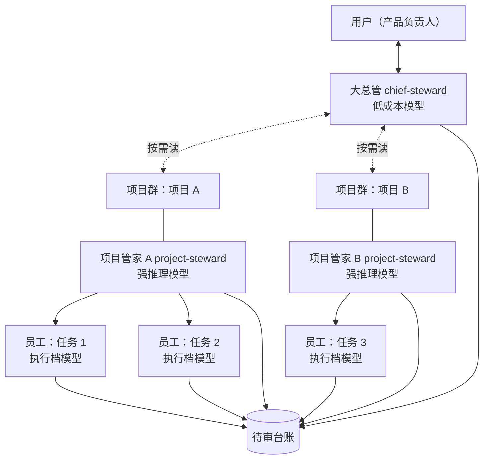
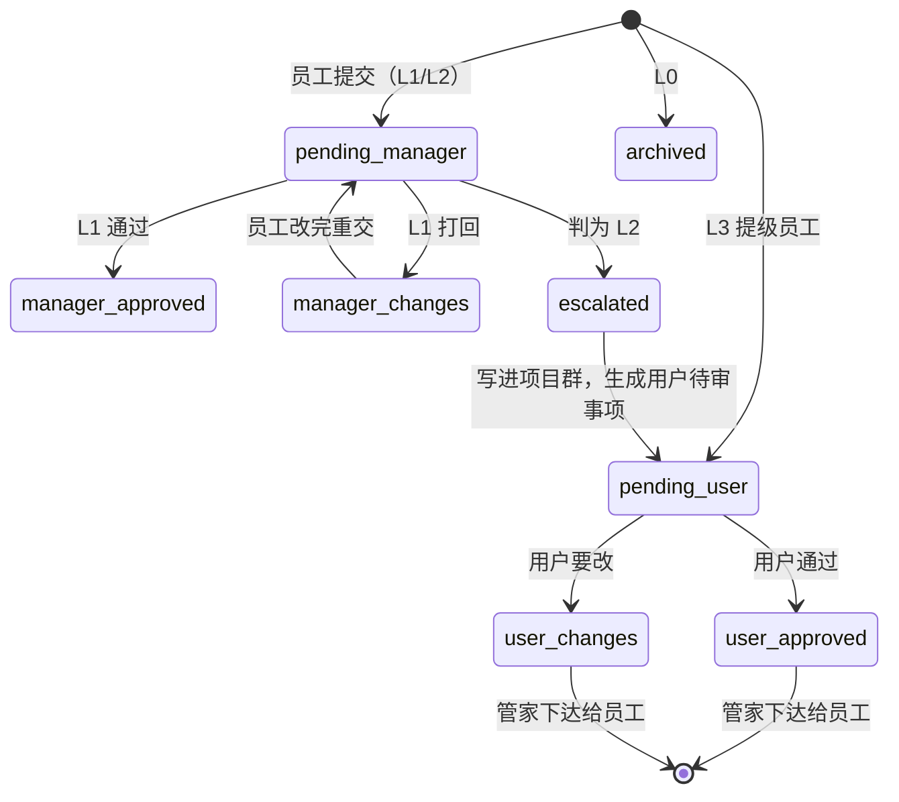

# 方案层：三层个人管家体系与汇报等级

## 面向谁

个人使用者：同时推进多个项目，每个项目在 Codex、Claude Code、Antigravity 等编程运行时里有多个长时间运行的 Session。使用者是产品负责人，不看技术细节，只做顶层业务决策。

## 痛点

1. 每个任务都要跑很久，需要使用者审的东西留在某个 Session 的对话里，没有明确的“待审”状态，过几天就忘了。
2. 所有结果都推给使用者目检，技术细节和产品决策混在一起，使用者既看不懂也审不过来。
3. 不同角色用同一档模型：传话和记事用强模型浪费，审业务用弱模型不可靠。
4. 每开一个执行 Session 都要使用者批准，打断频繁。

## 三层角色与模型档位

| 角色 | 职责 | 模型档位 | 示例配置（由使用者在 local rules 指定） |
|---|---|---|---|
| 大总管 | 传话、管事项与日程、列待审清单、跨项目总览 | 低成本 | OpenClaw 上的便宜模型 |
| 项目管家 | 懂业务；出方案、派员工、审 L1、判等级、上报 L2 | 强推理 | Claude Code 上的 Opus 档模型，或 Antigravity 上的强模型 |
| 员工 | 一个任务一个 Session，实现、测试、产出文件 | 执行档 | Antigravity 或 Codex |

硬约束：专业问题不交给大总管审。大总管遇到专业问题只转给项目管家，再把答复带回。

原 `portfolio-steward` 承担母版审查与跨仓库规则评审，属于专业判断，改称“母版管家”，与大总管分开。

## 汇报等级

| 等级 | 谁审 | 适用 |
|---|---|---|
| L0 自理 | 员工 | 过程记录、中间产物 |
| L1 管家审 | 项目管家 | 技术方案、实现细节、证据、不改变产品行为的取舍 |
| L2 上报用户 | 用户 | 产品设计、业务语义、用户可见行为、范围优先级、付费或不可逆决定 |
| L3 提级 | 用户直接看 | 用户点名要盯的员工，其文件跳过管家初审 |

等级由项目管家判定，员工只建议，大总管不能改。

## 文件流转

员工状态：排队 → 执行中 → 等审 → 执行中 → … → 完成 / 失败 / 已交接；“等审”必须对应至少一份 `blocking` 文件。

## 对象关系

- 项目 1 — 1 项目管家 Session — 1 项目群
- 项目 1 — N 任务；任务 1 — 1 员工 Session（接续时换新 Session，旧的标“已交接”）
- 员工 1 — N 文件；文件带等级和状态
- 用户的事项 = 用户自己的待办 + 由 `pending_user` 文件自动生成的“待审”事项 + 管家提出的、必须由人动手的步骤；批复或做完后完成
- 事项拆分门：只有需要人亲自操作或拍板的步骤才是事项；AI 能自己做完的步骤是员工内部进度，不拆成事项
- 用户界面是原生 App，台账是它的数据源；不用多维表格当用户界面（可读性差）

## 主路径

1. 用户在大总管处说“给项目 A 做某件事”，大总管转进项目群并点名项目管家。
2. 项目管家定方案，在员工预算内直接派员工，并在下次汇报说明。
3. 员工产出方案或代码后，写台账、发终态回传，停下等审。
4. 项目管家审：技术问题自己通过或打回；涉及产品决策的判为 L2，写进项目群。
5. 大总管把 L2 排进用户的待审清单并提醒；用户批复后，大总管把原话写回台账和项目群。
6. 项目管家把批复转成指令派回原员工。

## 可行性

- Codex：`codex exec resume <id>`、App 的线程工具都可派单、续接、等待。
- Claude Code：`claude -p --resume <id>` / `--session-id` 可续接；员工必须是顶层会话，不能用会话内 sub-agent。
- OpenClaw：`sessions_spawn` / `sessions_send` 可调 Codex 与 Claude Code；后台命令发完成通知会被丢弃，需改用 `sessions_yield` 或台账。
- Antigravity：会话接口尚未核实，首次使用前实测。
- 三方都不提供跨运行时的待审台账，这是本方案要补的部分。

## 本期交付

- `project-steward`：三层分工与模型档位、汇报等级、项目群、员工预算、台账交接、跨运行时指引。
- 新增 `chief-steward`（大总管）Skill。
- `portfolio-steward` 改称母版管家，并与大总管划清边界。
- 参考文件：`review-ledger.md`（台账字段、事项拆分门、状态机、读写权限）、`runtimes.md`（跨运行时能力对照）及合成示例数据。

## 不做什么（本期）

- 不写台账读写脚本、会话结束钩子和手机 App 接入代码，只定义契约。
- 不实测 Antigravity 接口。
- 不把这些规则自动下发到已派生的子仓库管家；按母版管家的三方同步流程另行处理。
